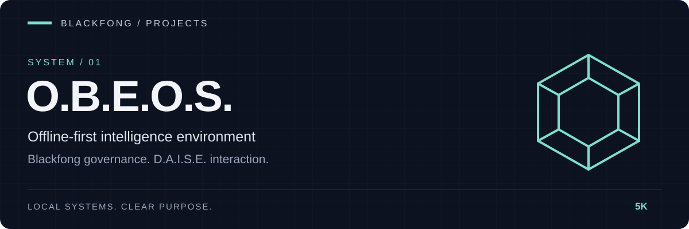

<div align="center">



**Offline-first intelligence environment.**


[Quick start](#quick-start) · [Product identity](#current-product-truth) · [Architecture](#architecture-summary) · [Packaging](#packaging-status)

</div>

---

# O.B.E.O.S.

| Govern | Interact | Inspect |
|---|---|---|
| Blackfong spine, policy and memory | D.A.I.S.E. and native Workspace | Thoughtglass and Memory Chamber |

O.B.E.O.S. is the **Official Blackfong Environment Operating System**: a sovereign, offline-first intelligence environment built around one governing spine, one shared memory system, and multiple operator surfaces.

This repo is not just a chat UI.

It is the active product source for:

- the **Blackfong** governing spine
- the **D.A.I.S.E.** visible assistant
- the native **Blackfong Workspace** operator shell
- the **Thoughtglass** live cognition surface
- the **Memory Chamber** analysis workbench
- the Kubuntu/Plasma O.B.E.O.S. deployment and branding path

## Current Product Truth

These are the current rules that packaging and branding should follow.

- **Product name**: `O.B.E.O.S.`
- **Governing authority**: `Blackfong`
- **Machine identity**: `Blackcomputer`
- **Visible assistant**: `D.A.I.S.E.`
- **Canonical operator shell**: `Blackfong Workspace` (PySide6)
- **Live cognition surface**: `Thoughtglass`
- **Deep graph/archive workbench**: `Memory Chamber`
- **Thoughtglass HUD**: supported browser-based secondary cockpit for remote access, debugging, and fallback
- **TUI**: supported fallback/home surface, not the canonical product shell

## v2 Architecture Direction

O.B.E.O.S. v2 keeps the v0.9 governing spine and contracts while adding a multimodal cognitive architecture.

The core rule is:

> **Events describe what happened. Context describes what is happening. D.A.I.S.E. determines what it means and what to do.**

The v2 architecture introduces a `context_fabric` layer between the event fabric and D.A.I.S.E. so raw subsystem activity does not become conversational noise. D.A.I.S.E. becomes multimodal at the cognitive layer, while specialized systems such as 3000, EarthGlass, and BlackForge provide observations, evidence, and capabilities.

BlackForge evolves into O.B.E.O.S.'s multimodal engineering, diagnostic, automation, and reasoning specialist with capability-based model routing. It does **not** replace D.A.I.S.E. or `event_backbone`.

See [`docs/OBEOS-v2-architecture-patch.md`](docs/OBEOS-v2-architecture-patch.md) for the full architecture and implementation plan.

## Surface Hierarchy

O.B.E.O.S. now has a clear surface hierarchy:

- **Primary local operator experience**:
  - `blackfong desktop workspace`
  - `blackfong desktop start`
  - native PySide6 `Blackfong Workspace`
- **Secondary cockpit**:
  - `blackfong hud`
  - browser-based remote/debug/operator access
- **Fallback/home authority surface**:
  - `blackfong tui`
  - `blackfong home`

Thoughtglass HUD is still important, but it is no longer the entire product.

## Quick Start

```powershell
git clone https://github.com/5K-bit/O.B.E.O.S.git
cd O.B.E.O.S
python -m venv .venv
.\.venv\Scripts\activate
pip install -r requirements.txt
python -m blackfong_ecosystem.cli init
python -m blackfong_ecosystem.cli verify automated
python -m blackfong_ecosystem.cli desktop workspace
```

If you want the browser cockpit too:

```powershell
python -m blackfong_ecosystem.cli hud
```

## Release And Deploy Record

O.B.E.O.S keeps two complementary history tracks:

- repo-tracked product history in `docs/obeos-release-log.md`
- runtime deploy history on cloud hosts in `data/deploy-history.log`

Working rule:

- local edits happen here first
- meaningful commit messages describe the improvement made
- GitHub keeps the canonical source history
- cloud pulls stay fast-forward-only and append a deployment entry after rollout

When you push or pull, leave notes that answer:

- what changed
- why it changed
- what operator or runtime behavior it should improve
- which revision is now live

## Core Commands

### System and surfaces

```powershell
blackfong init
blackfong verify automated
blackfong verify surfaces
blackfong verify integrations
blackfong verify full

blackfong desktop status
blackfong desktop start
blackfong desktop workspace
blackfong desktop stop

blackfong hud
blackfong tui
blackfong home
```

### Spine and agents

```powershell
blackfong spine status --mode learning
blackfong agent list --mode full
blackfong agent admit vision
blackfong tiny status
blackfong vision smoke
```

### Memory and event flow

```powershell
blackfong event-log --source user --type agent_query --text "hello" --session-id demo-session --correlation-id demo-correlation --tag boot
blackfong memory-query --keyword "hello"
blackfong daise-session "Summarize the current system state."
```

### O.B.E.O.S. packaging and VM flow

```powershell
blackfong obeos manifest
blackfong obeos shell-compat
blackfong obeos materialize --output data\obeos-remaster
blackfong obeos vm-checklist
blackfong obeos vm-acceptance-snapshot
blackfong obeos activate-home
blackfong install-plan status
blackfong install-plan validate --profile amd64-pc
```

## Kubuntu Session Contract

O.B.E.O.S. v1 standardizes on:

- `Kubuntu 24.04 LTS`
- `KDE Plasma`
- Linux shell compatibility for normal Ubuntu/Kubuntu workflows

Session doctrine:

- O.B.E.O.S. owns the session
- Plasma is a managed workspace, not a second authority
- `blackfong desktop start` enters managed Blackcomputer workspace mode
- `blackfong home` returns the machine to the O.B.E.O.S. home surface

Bootstrap doctrine:

- **Stage A** keeps `graphical.target` active while the workspace, HUD, and related surfaces are smoke-tested
- **Stage B** is explicit `blackfong obeos activate-home`
- degraded fallback is mandatory if TUI-home cannot start cleanly

## Integration & Stabilization

The v0.9 stabilization branch freezes these rules:

- canonical child projects are pinned submodules rather than duplicated editable copies
- OBEOS components declare `obeos.manifest.json` schema v1
- component discovery is manifest-driven
- cross-component health uses OBEOS Health Contract v1 with MaxPayne as aggregator
- cross-component events use OBEOS Event Contract v1
- D.A.I.S.E. is model-led; memory, retrieval, system state, and tools provide context rather than replacement intelligence
- release-facing identity uses O.B.E.O.S., Blackfong, Blackcomputer, and D.A.I.S.E.
- the shipping installer targets Kubuntu 24.04 LTS + KDE Plasma

See `docs/obeos-integration-stabilization-phase.md` and `docs/obeos-v0.9-release-gate.md`.

## Packaging Status

This repo already contains:

- a native workspace shell
- a Thoughtglass HUD browser cockpit
- a remaster/materialize bundle path
- Linux guest branding generation
- a VM checklist and acceptance snapshot path
- an installer-plan validation service

The v0.9 release candidate remains gated on passing the full integration matrix and producing fresh release evidence from a clean checkout.

## Architecture Summary

### Core components

- **Blackfong**: governing spine, routing authority, policy, memory governance
- **D.A.I.S.E.**: visible operator assistant and future multimodal cognitive layer
- **Blackcomputer**: orchestrator host and knowledge vault
- **Thoughtglass**: live operational cognition surface
- **Memory Chamber**: deep graph/archive and analysis workbench
- **Mobray**: question-only interrogator
- **TinyProgrammer**: companion participant and artifact generator
- **BlackForge**: engineering, diagnostic, automation, and multimodal reasoning specialist
- **3000**: perception specialist
- **EarthGlass**: Earth/environment specialist
- **`context_fabric`**: v2 situation-building and relevance boundary between events and D.A.I.S.E.

### Storage and memory

- immutable event spine in SQLite
- local vector storage behind the existing abstraction
- unified cognition graph for Thoughtglass / Memory Chamber / D.A.I.S.E. retrieval
- shared conversation memory across workspace, HUD, and TUI
- v2 evidence references for multimodal observations and large artifacts

### Product direction

The product is moving toward:

- stronger native-shell-first operation
- manifest-driven component integration
- contract-driven health and events
- multimodal D.A.I.S.E. reasoning
- situation-aware context aggregation
- multimodal BlackForge engineering and diagnostics
- packaging-ready Kubuntu/Plasma deployment
- a reproducible OBEOS v0.9 release candidate with a v2 architecture path
