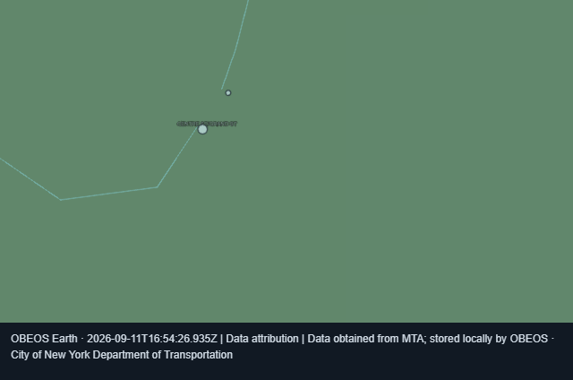
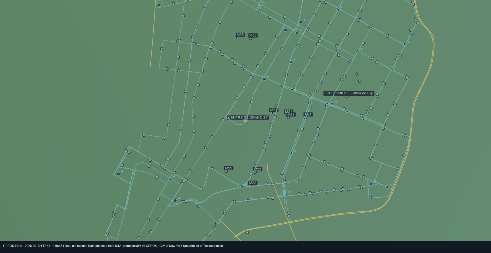

# Earth V2 and Mobility / Presence acceptance

Updated 2026-09-12. The implementation is available in the working tree and rebuilt local wheels. Native functional checks have passed for the tested offline workflow. **Full release acceptance is still open:** broader performance/scaling/recovery checks, Kubuntu, selected live feeds and the user-deferred Presence deployment remain.

The requested product scope is preserved in [Earth V2](specifications/earth-v2.md) and [Mobility & Presence](specifications/mobility-presence-v1.md). See the [operator guide](earth-v2-operator.md) for launch, offline imports, optional free keys and later private-host setup.

## Decisions and defaults

- Offline startup needs no credentials or cloud service. Named public providers may use optional free accounts/keys. NASA FIRMS, 511NY and MTA Bus Time remain disabled until configured.
- Cloud Node, Tailscale, Traccar host setup and phone enrollment are deferred at the user's request. No real device, viewer credential or tracking session was created.
- Private Presence has a separate store, authentication and API. It does not publish personal fixes into public observations or the event backbone.
- The newer V2 specification excludes military identification, paid integrations, unrestricted camera discovery and AIS selection from this release.
- Existing uncommitted ecosystem changes were preserved; no commit or deployment was performed.

## Verified implementation

| Area | Implemented behavior | Evidence and remaining limit |
|---|---|---|
| Spatial foundation | Versioned observations, provenance, lifecycle/data health, bounded shared acquisition, persistence, stale fallback, viewport/time pagination and resumable updates | Backend regression suite; 50 registered adapters in the installed-wheel check |
| Weather | GFS fields through Open-Meteo, explicit units/nulls and hourly timeline selection | Fixture tests. Nine geographic samples per view; not a continuous detailed weather field |
| Satellite imagery | Eight NASA GIBS / GOES categories, two overlays maximum, opacity and past-frame resolution, bounded tile cache | Catalog verified against official metadata; tile/cache contracts covered. Not all eight live imagery products were visually verified in this run |
| Satellites | Six CelesTrak groups, persisted OMM and local SGP4, source epoch and predicted labels, bounded tracks | Cache/restart/epoch tests; 21 locally propagated objects in the recorded source probe |
| Aircraft and earthquakes | Existing public aircraft with OpenSky fallback, bounding-box queries, time/depth/magnitude fields and object inspection | Existing adapter/spatial coverage retained. Broad live flight coverage is not an acceptance claim |
| Alerts, fire and natural events | NWS polygons / affected-zone cache, FIRMS hotspots, EONET geometry, source time and expiration | Deterministic coverage. FIRMS key not configured; initial NWS zone coverage is partial |
| Aviation and space weather | Five AWC products; SWPC Kp, reported geomagnetic scale, solar wind and alerts; partial failures retain product timestamps | AWC / SWPC fixtures and selected real-source probes |
| Traffic | NYC DOT sensor lines; optional 511NY incidents, construction, closures and winter conditions | Real NYC segments and fixture-based 511 coverage. NYC speed/travel-time units and expected-speed baseline remain unconfirmed, so normalized congestion stays unknown |
| Cameras | Official camera metadata, selectable objects and official player links; existing supported public still-image panel | 511 fixture coverage. Keyed 511 camera playback not live verified; unsupported official players open externally |
| Transit | MTA GTFS-RT actual fixes, alerts, incremental markers, recent-fix interpolation; local GTFS routes/shapes/stops | Real LIRR fixes and official Manhattan import. MTA Bus Time key not configured; station-only subway reports are not invented positions |
| Desktop Earth | Earth home, layer controls, inspector, tracking/camera, timeline, annotations, saved scenes and diagnostics | Browser and native offline rendering, inspection, active-orbit reload, route toggles and attributed scene saving passed; broader platform/performance limits are below |
| Private Presence | Disabled defaults, registered-device binding, Traccar ingestion, authenticated API, age states, history, retention, expiring/revocable grants and read-only viewer | Automated privacy/permission/history tests and bundled private-viewer build. No live phone or family-viewer acceptance yet |
| Presence presentation | Separate marker layer, accuracy, close/city/regional follow, custom trail interval and timeline history | Code and contracts implemented; physical-device follow/history verification deferred with host setup |
| Packaging | Bundled local Cesium assets and separate private viewer, Windows/Linux dependency locks, isolated wheel imports and offline lifecycle | Fresh wheel check passed. Linux lock generation is not a Kubuntu desktop run |

## Rendering defects fixed during this review

Floating-point camera drift repeatedly submitted viewport changes and cancelled paginated loads before the scene could finish loading. Camera-change comparison now ignores insignificant drift, and the normalized observation endpoint avoids redundant recursive response encoding. The final browser loaded 2,153 retained objects at city scale.

Dense stop collections could also consume the entire visible-entity budget. Viewport intersection now includes route/polygon bounds, and part of the budget is reserved for geometry so routes remain visible beside stops.

At close zoom, the final browser rendered 31 viewport objects, including route geometry and stops. Selecting **CENTRE ST/GRAND ST** opened the common inspector with MTA attribution and an explicit imported-stop label. Reload retained the selection and view. Save Scene wrote a PNG with attribution, which was opened and inspected.

The green background is the bundled low-resolution overview at street scale. Detailed offline streets/buildings are not bundled. Imported transit provides geometry without pretending the overview contains street imagery.

## Native verification completed on 2026-09-11 and 2026-09-12

The unlocked Windows check found and fixed two additional defects:

- Reloading during orbit restored the camera position before its target was loaded. Selected, tracked and camera-owned contacts are now fetched explicitly outside the viewport when necessary, using the replay time when applicable. Saved investigations remain fixed snapshots.
- Numerical camera drift repeatedly acquired the continuous-render hold even while stationary. Meaningful position/direction changes now govern that hold, allowing full resolution to return after movement settles.

Map labels now use larger text with a restrained background. Native reload timing measures the current page load instead of total window uptime. Renderer metrics report active owners and distinguish idle/hidden periods; long active stalls are no longer silently discarded.

Observed native checks passed for offline startup, close/regional route rendering, selected-stop inspection, active-orbit reload, overhead view, independent route disable/re-enable, attributed scene saving, and clean owned-resource shutdown. Ctrl+R worked. Broader keyboard-only navigation, forced renderer crashes and alternate display scaling were not exercised.

The final stationary export is **1920×991** including its attribution footer; the earlier blurred export was 960 pixels wide. Routes, stops and labels were visually inspected in the saved image.

On Intel UHD Graphics (driver 31.0.101.2137) and a 1920×1080 display, the final orbit run recorded:

- Runtime startup: **6.25 s**; page-load display: **1.08 s**.
- 2,443 active frame intervals, 27 completed sample windows.
- Final frame p50 **33.4 ms**, p95 **43.1 ms**; worst sample-window p95 **236.6 ms**.
- 513 loaded contacts, 200 rendered; adaptive active canvas **960×472**, resolution scale 0.5.
- Owned process memory **1,281.7 MiB** and no reported shutdown errors.

This is evidence of approximately 30 FPS for the median frame in the tested offline orbit scene, with occasional stalls and reduced moving resolution. It is **not** a guarantee of sustained full-resolution 1080p / 30 FPS with every live layer enabled. Idle full-resolution recovery is separately verified by the image above.

Evidence: [final native metrics](validation/earth-v2-native-final-2026-09-12.json), [earlier orbit metrics](validation/earth-v2-native-orbit-2026-09-11.json), [camera-drift reproduction](validation/earth-v2-native-idle-before-fix.json), and [latest validation record](validation/earth-v2-2026-09-12.json).

## Reproducible checks and results

| Check | Result |
|---|---|
| EarthGlass plus Earth Control, outbox, background delivery and desktop cancellation tests | **169 passed**; existing Pydantic deprecation warnings remain |
| Follow-up spatial-history, planetary V2 and Earth Control checks after final Python API changes | **79 passed**; overlaps the broader suite, not 79 additional unique tests |
| Native host / Earth Control follow-up | **53 passed** after the native reload/metrics changes; overlaps earlier suites |
| Final frontend suite | **29 passed** in 11 files |
| Final frontend production build | Passed, with Vite's large Cesium chunk warning |
| Python undefined/unused-name checks for final API changes | Passed |
| Dependency integrity, canonical repository paths, generated Python/TypeScript contracts | Passed |
| Fresh installed wheel / assets / offline API smoke test | Passed; **50 providers**, **6.00 s** runtime startup in the final installed-wheel check |
| 10,000-track cached backend query benchmark | p50 **43.33 ms**, p95 **93.38 ms**; below the 250 ms cached-query target |
| Browser offline zoom / selection / reload / attributed snapshot | Passed |
| Native Windows offline workflow | Passed for rendering, active-orbit reload, route controls, snapshot and shutdown |
| Alternate display scaling / forced renderer-crash recovery | Not exercised |
| Kubuntu native startup/shutdown | Not run on this Windows machine |
| 1080p / Intel UHD approximately 30 FPS gate | Median near 30 FPS in the tested adaptive offline scene; stalls and reduced moving resolution remain |

The query benchmark measures cached backend queries, not HTTP round-trip or end-to-end browser latency. The browser review used a 1280×720 surface and an adaptive 640×360 canvas. Its captured sample had frame p50 33.3 ms and p95 452.4 ms, with a 200-entity budget. This does not establish sustained 30 FPS or a 1080p performance pass. The review host also ran diagnostic sampling; this capture is observational rather than a controlled GPU benchmark. The host stopped without reported owned-resource shutdown errors.

Commands (from the repository root, using the locked environment):

    python -m pytest EarthGlass/tests tests/test_earth_control.py tests/test_event_outbox.py tests/test_background_delivery.py tests/test_desktop_cancellation.py -q
    python -m pytest EarthGlass/tests/test_spatial_history.py EarthGlass/tests/test_planetary_v2.py tests/test_earth_control.py -q
    pnpm --dir EarthGlass/obeos-earth test
    pnpm --dir EarthGlass/obeos-earth build
    python tools/build_earth_release.py
    python tools/verify_earth_wheels.py

For a browser-versus-Qt comparison, capture the same fixture scene and canvas
dimensions first, then run:

    python tools/compare_earth_render_metrics.py --browser browser.json --qt qt.json --scene "offline fixture" --workload "simulated tracks" --output artifacts/earth-render-comparison.json

The comparison command refuses mismatched canvas dimensions. It reports frame
time, adaptive resolution and owned-memory deltas, but never infers graphics
acceleration or scene equivalence when those facts were not recorded.

## Live verification is separate from fixtures

[Recorded source responses](validation/live-v2-2026-09-11.json) at 16:25 UTC:

- SWPC products were received; METAR returned 15 observations.
- NYC DOT returned 123 usable sensor segments, with 30 old records rejected.
- LIRR returned 55 actual positions.
- The official Manhattan GTFS archive imported 307 route definitions and 1,824 stops; 158 mapped route/shape objects were available.
- CelesTrak cache propagation produced 21 orbital observations.
- EONET returned no events in the selected bounds.
- NWS returned no mapped observations in those bounds, with 149 records rejected/unmapped; this is **partial coverage**, not evidence that no alerts existed.
- The SIGMET probe returned no observations with two rejected/unavailable source results.

No live-success claim is made for every registered source, for FIRMS/511NY/Bus Time without their keys, or for a real Presence device.

## Remaining release gates

1. Extend the completed native offline check to keyboard-only navigation, alternate display scaling, forced renderer-crash recovery, and broader live-layer / Intel UHD stress profiles. Reduce the remaining moving-frame stalls before claiming a sustained full-resolution performance pass.
2. Repeat desktop acceptance on Kubuntu.
3. Verify optional keyed sources after the user supplies credentials through the OS broker; verify the relevant source's imagery/camera playback and attribution. Confirm NYC sensor units/baseline before enabling normalized congestion colors.
4. If street-scale offline imagery is required, choose and install an attributable local map dataset. The shipped overview alone cannot satisfy that detail level.
5. At the user's later setup step, deploy private Traccar / gateway / Tailscale, register the authorized phone, and verify delayed fixes, status, follow, history, retention, viewer restrictions and revocation end to end. Native local Presence storage and a future gateway store are separate; automatic cloud-to-desktop synchronization is not configured.

Machine-readable evidence: [latest validation record](validation/earth-v2-2026-09-12.json), [earlier validation record](validation/earth-v2-2026-09-11.json), [browser metrics](validation/earth-v2-browser-metrics.json), [wheel smoke check](validation/wheel-smoke.json).
